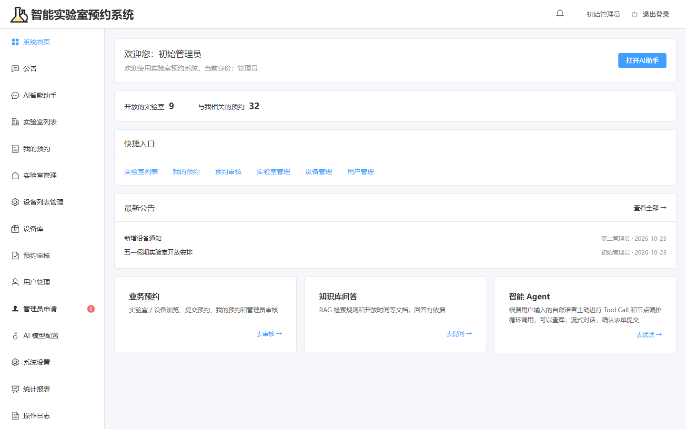
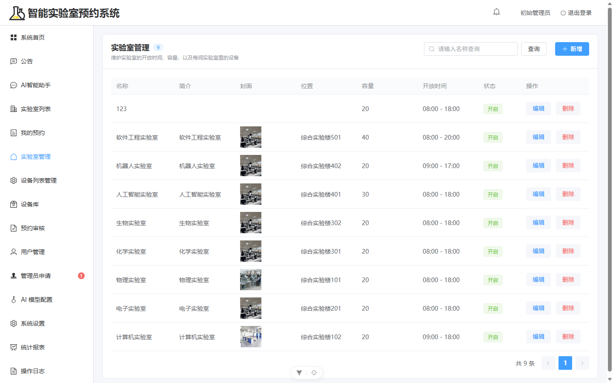
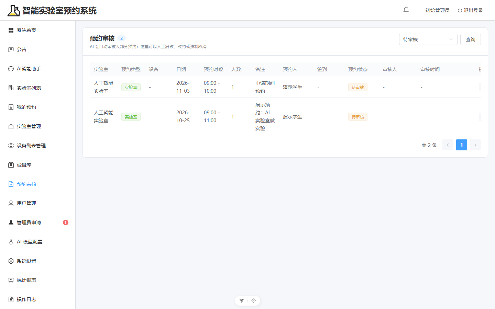
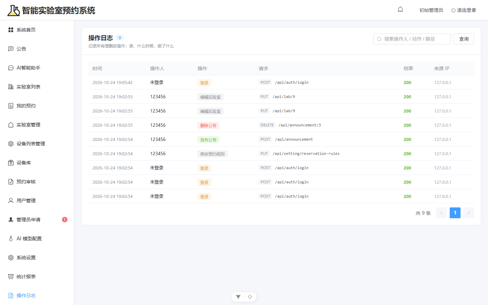
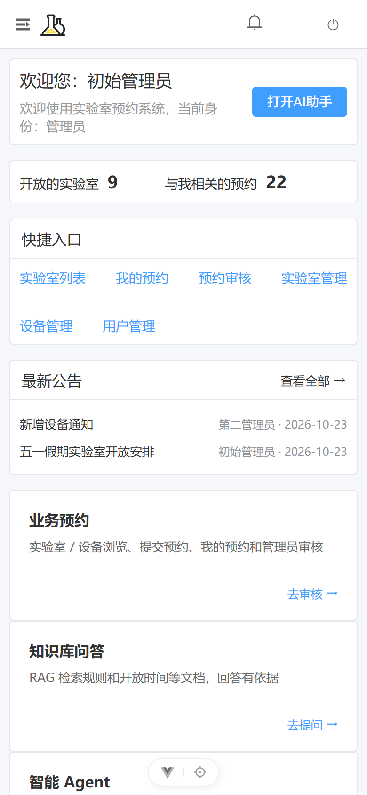
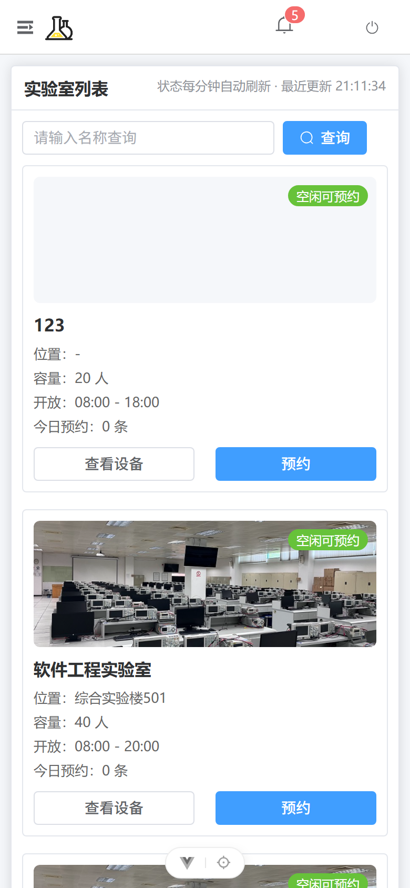

# 智能实验室预约系统（lab-agent）

基于 **FastAPI + Vue 3 + LangGraph** 的实验室预约系统，带 **AI 自动审核预约**、签到与违约管理、统计报表和操作日志。
单人/小团队可一键部署，也能打包成独立安装包发给别人自己跑。



## 项目来源与致谢

> 本项目**基于公开的课程示例项目二次开发**（FastAPI + LangGraph 实验室预约系统）。
> 原始项目的设计与版权归原作者所有，仓库中的代码是在其基础上重构与扩展而来。

在此基础上完成的主要工作：

| 方向 | 具体改动 |
|---|---|
| 业务补全 | 新增公告（分级删除）、通知中心（角标 + 历史页）、设备库、签到与违约机制、统计报表、操作日志 |
| AI 审核 | 接入 LangGraph Agent 自动审核预约，增加关键词前置拦截 + 机械校验兜底，控制小模型误判 |
| 并发修复 | 用锁包住「冲突校验 + 写入」临界区，解决同时抢同一时段导致的重复预约 |
| 数据库 | SQLite → MySQL 8 迁移（10 张表 / 194 行逐表校验），保留回滚方案，补充迁移与导出脚本 |
| 前端 | 重构 22 个页面，统一表格页风格，自研响应式方案支持手机浏览器直接使用 |
| 工程化 | 26 项接口冒烟 + 24 页面巡检脚本，独立部署包（内置运行时，双击即用） |

> 如果你是原始项目的作者并希望调整署名方式，请提 issue 联系。

## 功能

| 模块 | 说明 |
|---|---|
| 账号 | 注册（学生 / 申请管理员）、登录、管理员审批、管理员重置密码 |
| 权限 | 主管理员 / 普通管理员 / 学生三级，接口层 + 前端双校验 |
| 实验室 | 增删改查、实时占用状态、关闭实验室时自动取消后续预约 |
| 设备 | 全局设备库 + 各实验室设备，支持按设备预约 |
| 预约 | 提交（填人数）→ **AI 自动审核** → 站内通知；冲突 / 时长 / 每日次数 / 容量全校验 |
| 自助 | 修改预约（次数 + 时间窗口）、取消（截止时间）、**签到** |
| 违约 | 未签到自动记违约 → 通知管理员 → 累计自动禁用账号 |
| 公告 | 发布 / 编辑 / 分级删除，学生看不到发布人 |
| 通知 | 铃铛角标、点击跳转、历史列表、未读筛选 |
| 统计 | 使用率、热门时段、违约明细（可点开详情） |
| 审计 | 操作日志（仅主管理员可见） |
| AI 助手 | 流式对话、知识库问答（RAG）、工具调用查库 |
| 移动端 | 手机浏览器直接可用，抽屉菜单 + 单列卡片 + 表格横滑 |

### 界面

| 实验室管理 | 预约审核 |
|---|---|
|  |  |

| 操作日志 |
|---|
|  |

<p float="left">
  
  
</p>

## 技术栈

- **后端**：FastAPI · SQLAlchemy 2 · Pydantic v2 · JWT · bcrypt
- **数据库**：MySQL 8（也支持 SQLite）
- **AI**：LangGraph / LangChain Agent · OpenAI 兼容接口（默认接本机 Ollama）
- **前端**：Vue 3 · Vite · Element Plus · Axios
- **移动端**：响应式 CSS（≤768px 断点），无独立 App

## 快速开始

### 1. 准备环境

- Python 3.10+
- Node.js 18+
- MySQL 8（或直接用 SQLite）

### 2. 后端

```bash
cd backend
pip install -r requirements.txt
cp .env.example .env      # 改成你自己的数据库地址和密钥
uvicorn app.main:app --host 0.0.0.0 --port 8001
```

首次启动会自动建表，并创建初始管理员 **123456 / 123456**。
接口文档：http://127.0.0.1:8001/docs

### 3. 前端

```bash
cd frontend
npm install
npm run dev -- --port 5173
```

打开 http://127.0.0.1:5173

### 4. AI（可选）

默认连接本机 [Ollama](https://ollama.com/)：

```bash
ollama pull qwen-local:latest
```

不装也能用：AI 助手会不可用，预约会进入「待审核」由管理员手动处理。

## 默认账号

| 账号 | 密码 | 角色 |
|---|---|---|
| 123456 | 123456 | 主管理员 |
| admin2 | admin123 | 普通管理员 |
| stu | stu123 | 学生 |

> 正式使用前请修改初始密码，并更换 `.env` 里的 `JWT_SECRET_KEY`。

## 目录结构

```
lab-agent/
├─ backend/            FastAPI 后端
│  ├─ app/
│  │  ├─ api/          路由
│  │  ├─ models/       ORM 模型
│  │  ├─ schemas/      请求/响应模型
│  │  ├─ services/     业务逻辑（预约、审核、统计、日志…）
│  │  └─ utils/        JWT、密码、响应封装
│  ├─ data/kb/         知识库（Markdown）
│  └─ requirements.txt
├─ frontend/           Vue 3 前端
│  └─ src/
│     ├─ views/        页面
│     ├─ api/          接口封装
│     ├─ layouts/      布局与菜单
│     └─ styles/       全局与移动端样式
├─ docs/screenshots/   README 用截图
└─ 使用说明.md / 运行说明.md   使用与运维文档
```

## 文档

- [使用说明](使用说明.md) — 学生 / 管理员操作手册
- [运行说明](运行说明.md) — 启动方式、端口、数据库、改动记录
- [部署文档](部署文档.md) — 原始项目的部署说明（部分内容已过时，以上面两个为准）

## 已知限制

- 业务异常统一返回 HTTP 200 + `code` 字段（历史设计）
- 时间字段以字符串存储（有格式校验，但不是强类型）
- 通知为 30 秒轮询，没有邮件/微信推送
- 单进程部署，适合几百人规模；全校上万人需要读写分离、Redis 锁、SSE 推送等改造

## License

MIT
